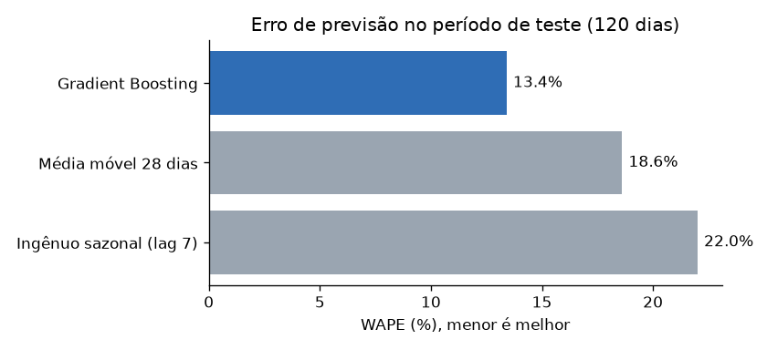
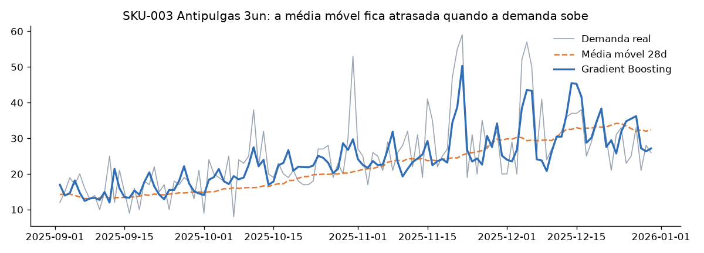
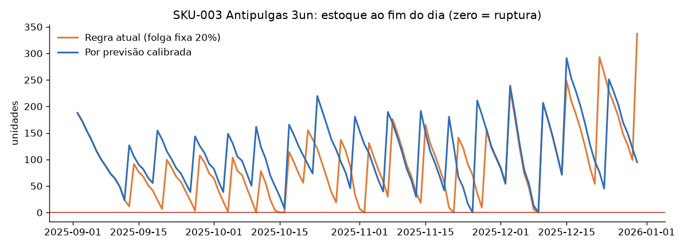

# Previsão de Demanda e Reposição de Estoque

Previsão diária de demanda por SKU e simulação do impacto da previsão na política de reposição: quanto capital em estoque é necessário para entregar o mesmo nível de serviço.

## Problema de negócio

Uma regra comum de reposição no varejo é "pedir quando o estoque cobrir a média dos últimos 28 dias × lead time, com 20% de folga". Ela é simples, mas reage com atraso: quando a demanda sobe (sazonalidade, promoção, produto em crescimento), a média ainda reflete o passado e o estoque acaba antes da reposição chegar. Para compensar, a saída costuma ser aumentar a folga, o que imobiliza capital em todos os produtos.

**Pergunta do projeto:** uma previsão melhor reduz rupturas e o capital necessário em estoque? Em quais condições?

## Resultados

Período de teste: 120 dias (set/2025 a dez/2025), 5 SKUs, dados sintéticos (ver [Limitações](#limitações)).

### 1. Precisão da previsão

| Modelo | WAPE | Viés |
|---|---|---|
| Ingênuo sazonal (mesmo dia da semana anterior) | 22,0% | -1,3% |
| Média móvel 28 dias | 18,6% | -4,2% |
| **Gradient Boosting** | **13,4%** | -3,7% |

O modelo reduz o erro em **28% frente à média móvel**. O ganho é maior no SKU sazonal (Antipulgas), em que a média móvel subestima a demanda em 11,9% durante a alta do verão, contra 3,3% do modelo.




### 2. Impacto no estoque (reposição semanal, nível de serviço alvo de 99,5%)

| Política | Fill rate | Unidades perdidas | Capital médio em estoque | Pedidos |
|---|---|---|---|---|
| Regra atual (folga fixa 20%) | 99,3% | 178 | R$ 48,5 mil | 84 |
| Regra atual calibrada para ≥ 99,5% por SKU | 99,8% | 48 | R$ 51,6 mil | 87 |
| **Por previsão, calibrada para ≥ 99,5% por SKU** | 99,7% | 92 | **R$ 46,4 mil** | 80 |

- **A regra atual parece boa no agregado (99,3%), mas falha onde a demanda muda:** Antipulgas fica em 95,9% de fill rate e concentra 121 das 178 unidades perdidas (R$ 12,1 mil a custo no total).
- **Para atingir o mesmo nível de serviço**, a política por previsão precisa de **10% menos capital** (R$ 5,2 mil) e emite 8% menos pedidos.



### 3. Quando a previsão NÃO compensa

| Cobertura por pedido | Alvo 99,0% | Alvo 99,5% | Alvo 99,9% |
|---|---|---|---|
| 7 dias (semanal) | -15,9% capital | -10,1% capital | -7,0% capital |
| 14 dias (quinzenal) | +3,6% capital | +1,8% capital | +3,1% capital |

Com reposição quinzenal, o estoque de ciclo é grande o suficiente para absorver o erro da média móvel, e a previsão não traz ganho. **O valor de prever melhor depende de quão enxuta é a operação.** Antes de investir em modelo, vale verificar a frequência de reposição.

## Como funciona

```
dados (vendas diárias, promoções, lead time)
   │
   ├─ previsao.py        → features com defasagem ≥ 7 dias, 3 modelos, WAPE/MAE/viés
   │                       erro do modelo em validação → estoque de segurança
   │
   └─ politica_estoque.py → simulação diária de reposição (ponto de pedido + nível máximo)
                            calibração das duas políticas para o mesmo fill rate
```

**Decisões de modelagem**

- **Anti-vazamento:** todas as features usam dados de pelo menos 7 dias antes da data prevista, então cada previsão é válida para horizontes de até 7 dias, cobrindo o lead time de todos os SKUs (3 a 7 dias).
- **Modelo global:** um único Gradient Boosting para todos os SKUs, com perda Poisson (adequada a contagens).
- **Promoções como feature:** entram porque são planejadas com antecedência.
- **Comparação justa:** as duas políticas têm a mesma estrutura de reposição. A única diferença é a estimativa de demanda, e cada uma é calibrada ao menor parâmetro que atinge o fill rate alvo.

## Como executar

```bash
pip install -r requirements.txt
python main.py
```

O dataset é gerado automaticamente se não existir (`src/gerar_dados.py`, semente fixa). Resultados em `resultados/`.

## Limitações

- **Dados sintéticos.** Os padrões (tendência, sazonalidade, promoções) foram gerados de propósito, então o modelo encontra sinal que existe por construção. Em dados reais, o ganho tende a ser menor.
- **Calibração no próprio período de teste.** Folga e z foram escolhidos olhando o resultado dos 120 dias, para as duas políticas. Isso torna os números absolutos otimistas; a comparação entre políticas continua válida porque ambas recebem a mesma vantagem.
- **Simplificações da simulação:** sem custo de pedido, lote mínimo, restrição de armazenagem ou variação de lead time; venda não atendida é perdida.
- **Capital calculado a custo**, não a preço de venda.

## Próximos passos

- Aplicar em um dataset público real (por exemplo, M5 Forecasting ou Store Item Demand, no Kaggle).
- Validação temporal com várias janelas (backtest rolling) em vez de um único corte.
- Incluir custo de pedido e lote mínimo para otimizar o trade-off entre capital e frequência de compra.

## Origem

Este projeto começou como um laboratório de ML no-code com Amazon SageMaker Canvas (Bootcamp DIO). Foi reconstruído em Python para ter controle sobre validação, vazamento de dados e tradução do erro de previsão em decisão de estoque.

## Estrutura

```
├── main.py                    # executa o pipeline completo
├── src/
│   ├── gerar_dados.py         # dataset sintético (5 SKUs, 2 anos)
│   ├── previsao.py            # features, modelos e métricas
│   └── politica_estoque.py    # simulação de reposição e sensibilidade
├── data/vendas_diarias.csv
└── resultados/                # métricas (.csv) e gráficos (.png)
```
